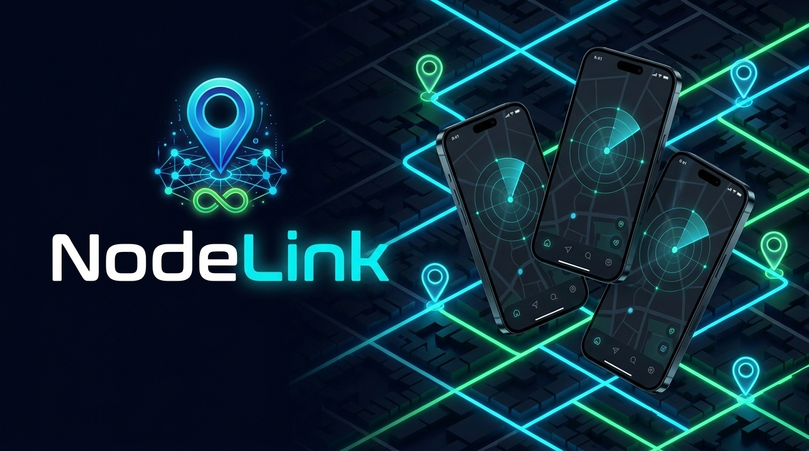
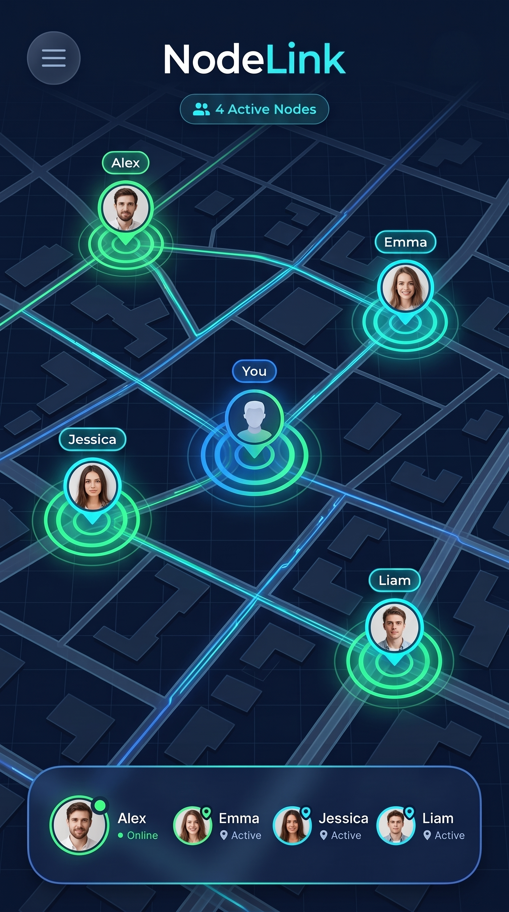
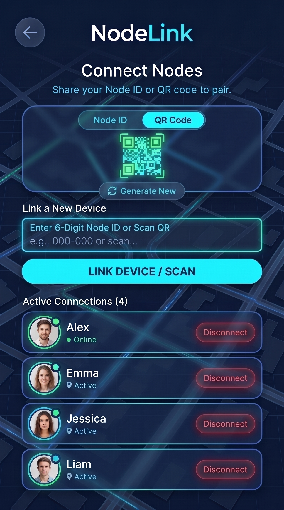
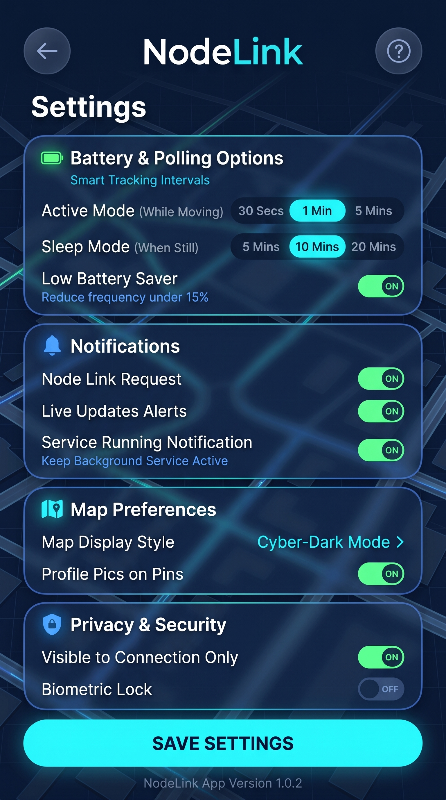
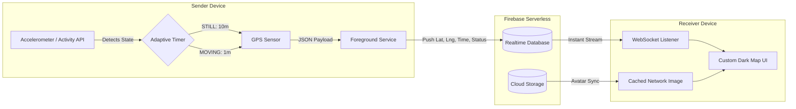

<div align="center">
  

  # NodeLink

  **Next-Generation Real-Time Location Telemetry & Peer Synchronization**

  [](https://flutter.dev)
  [](https://dart.dev)
  [](https://firebase.google.com)
  [](https://developers.google.com/maps)
  [](LICENSE)

  <p align="center">
    <a href="#-key-features">Key Features</a> •
    <a href="#-interface-preview">Interface</a> •
    <a href="#-system-architecture">Architecture</a> •
    <a href="#-tech-stack">Tech Stack</a> •
    <a href="#-getting-started">Getting Started</a>
  </p>

  
</div>

---

## 🌐 Overview

**NodeLink** is a modern, real-time live location tracking application built with Flutter and Firebase[cite: 1]. Engineered with a strong focus on **adaptive battery efficiency** and a sleek **Cyber-Dark UI**, NodeLink acts as a low-latency bridge to share GPS coordinates between trusted devices seamlessly in the background[cite: 1].

Instead of draining battery with constant high-frequency GPS locks, NodeLink uses on-device physical activity recognition to dynamically scale telemetry polling rates based on whether the user is stationary or in motion[cite: 1].

---

## 📱 Interface Preview

> **Note:** Place your generated UI assets inside `assets/images/` to render the gallery below[cite: 1].

<div align="center">
  <table>
    <tr>
      <td align="center"><b>Home Radar</b></td>
      <td align="center"><b>Connection Hub</b></td>
      <td align="center"><b>Node Profile</b></td>
      <td align="center"><b>Telemetry Settings</b></td>
    </tr>
    <tr>
      <td></td>
      <td></td>
      <td></td>
      <td></td>
    </tr>
  </table>
</div>

---

## ✨ Key Features

* 🔋 **Adaptive Battery Saver:** Integrates hardware accelerometer and physical activity recognition (`STILL` vs `MOVING`) to dynamically throttle GPS polling[cite: 1]:
  * **Stationary Mode:** Polls location every **10 minutes** to preserve battery life[cite: 1].
  * **Active Mode:** Scales to **1-minute intervals** when walking, running, or driving[cite: 1].
* ⚡ **Millisecond Synchronization:** Utilizes Firebase Realtime Database WebSockets to push lightweight JSON location payloads from sender nodes to receiver nodes instantaneously[cite: 1].
* 📷 **Instant QR & Node ID Pairing:** Link neighbor devices effortlessly by scanning an in-app glowing QR code or entering an auto-generated 6-digit Node ID[cite: 1].
* 🖼️ **Cloud Profile Avatars:** Compresses, uploads, and caches user profile avatars via Firebase Cloud Storage and local memory caching for zero-lag map markers[cite: 1].
* 🛡️ **Persistent Background Execution:** Keeps telemetry streams alive when the app is minimized, swiped away, or locked using persistent foreground services[cite: 1].
* 🛑 **Master Kill Switch:** A single, prominent UI toggle giving users immediate control to terminate all background tracking and sever active broadcasts for instant privacy[cite: 1].
* 🎨 **Cyber-Dark Material 3 UI:** Styled with a custom deep-navy (`#0A0F1D`), electric-cyan (`#00E5FF`), and neon-emerald (`#00FF87`) palette, complete with frosted glassmorphism cards and custom dark-mode Google Maps styling.

---

## 🧠 System Architecture

NodeLink treats every connected device as an autonomous data node[cite: 1]. Below is the end-to-end telemetry pipeline:



### Telemetry Payload Structure
Each broadcast pushes an ultra-lightweight JSON packet to minimize mobile data usage[cite: 1]:

```json
{
  "node_id": "NL-849201",
  "latitude": 6.927079,
  "longitude": 79.861244,
  "timestamp": 1761252840,
  "status": "MOVING",
  "battery_saver": false
}
```

---

## 🛠️ Tech Stack

| Layer | Technology / Package | Purpose |
| :--- | :--- | :--- |
| **Framework** | Flutter (Dart 3) | Cross-platform UI & native compilation[cite: 1] |
| **Database** | Firebase Realtime Database | Low-latency WebSocket coordinate syncing[cite: 1] |
| **Storage** | Firebase Cloud Storage | Profile avatar hosting[cite: 1] |
| **Map Engine** | Google Maps SDK | Custom dark-styled vector map rendering[cite: 1] |
| **Activity Sensor** | `flutter_activity_recognition` | Hardware motion state detection (`STILL` / `MOVING`)[cite: 1] |
| **QR Pairing** | `mobile_scanner` | Fast camera QR code scanning[cite: 1] |
| **Media Optimization** | `flutter_image_compress` | Client-side avatar compression prior to upload[cite: 1] |
| **Caching** | `cached_network_image` | Offline-first avatar rendering on map pins[cite: 1] |
| **IDE** | Android Studio / Antigravity IDE | Development & debugging environment[cite: 1] |

---

## 🚀 Getting Started

### Prerequisites
* **Flutter SDK:** `>=3.0.0`[cite: 1]
* **Firebase Account:** Active project with *Realtime Database* and *Cloud Storage* enabled[cite: 1].
* **Google Cloud Console:** Active *Maps SDK for Android / iOS* API key[cite: 1].

### Installation

1. **Clone the repository**[cite: 1]
   ```bash
   git clone [https://github.com/your-username/nodelink.git](https://github.com/your-username/nodelink.git)
   cd nodelink
   ```

2. **Install dependencies**[cite: 1]
   ```bash
   flutter pub get
   ```

3. **Configure Firebase**[cite: 1]
   Authenticate with Firebase and generate your `firebase_options.dart` configuration file using the FlutterFire CLI[cite: 1]:
   ```bash
   dart pub global activate flutterfire_cli
   flutterfire configure
   ```

4. **Inject Google Maps API Keys**[cite: 1]
   * **Android:** Add your key inside `android/app/src/main/AndroidManifest.xml`[cite: 1]:
     ```xml
     <meta-data
         android:name="com.google.android.geo.API_KEY"
         android:value="YOUR_GOOGLE_MAPS_API_KEY"/>
     ```
   * **iOS:** Add your key inside `ios/Runner/AppDelegate.swift`[cite: 1]:
     ```swift
     GMSServices.provideAPIKey("YOUR_GOOGLE_MAPS_API_KEY")
     ```

5. **Run the application**[cite: 1]
   ```bash
   flutter run
   ```

---

## 🔐 Required Permissions

Because NodeLink operates in the background, ensure the following permissions are accepted on first launch[cite: 1]:
* `ACCESS_FINE_LOCATION` & `ACCESS_COARSE_LOCATION`
* `ACCESS_BACKGROUND_LOCATION` ("Allow all the time")
* `ACTIVITY_RECOGNITION` (Required for Adaptive Battery Saver)
* `FOREGROUND_SERVICE`
* `CAMERA` (Required for QR Node pairing)

---

## 🗺️ Roadmap

- [ ] End-to-End Encryption (E2EE) for coordinate payloads
- [ ] Geofencing alerts (custom arrival/departure zones)
- [ ] Historical route playback & timeline export
- [ ] iOS Live Activities & Dynamic Island support

---

## 📄 License

Distributed under the MIT License. See `LICENSE` for more information.